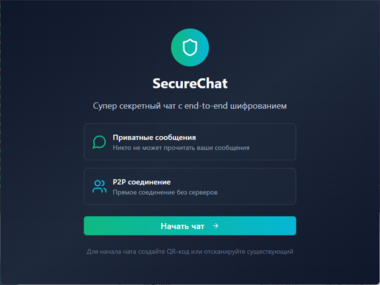
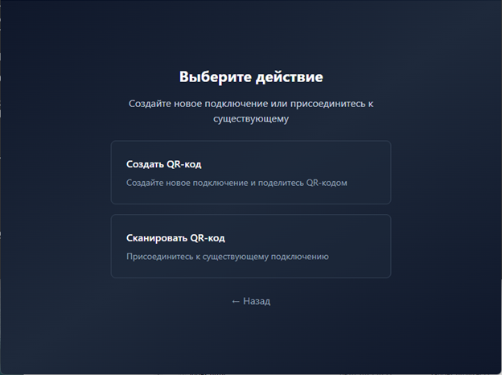
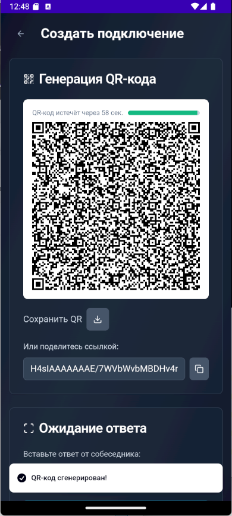
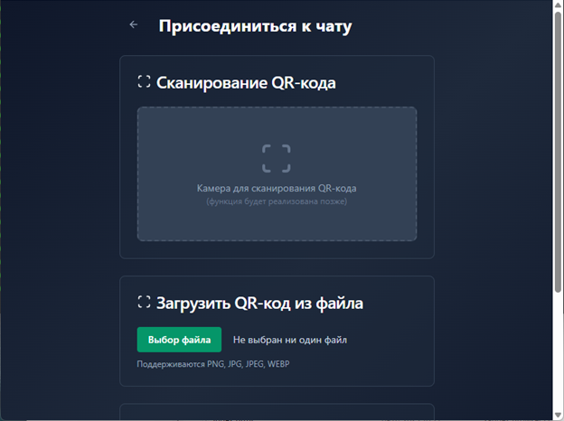
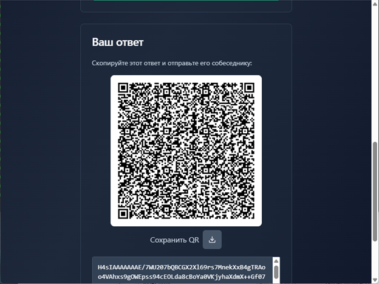
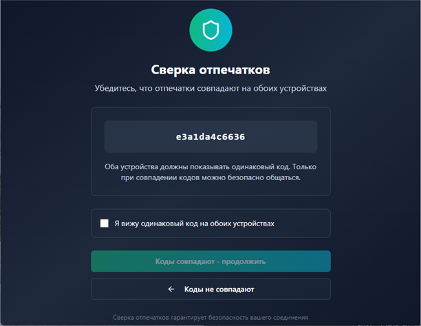
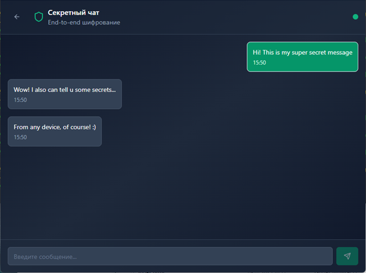
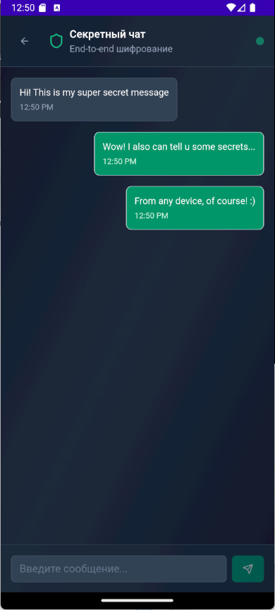
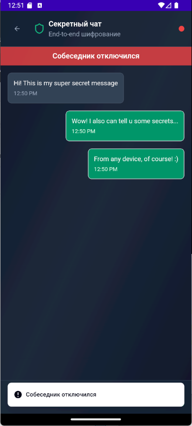

# ZeroID: Absolutely Secret Chat

> Desktop v3: [protocol, diagnostics and validation](docs/DESKTOP_PROTOCOL.md). Both participants must update; older invitations are unsupported.


## [🇷🇺](./README.ru.md)

**ZeroID** is an absolutely secret chat for secure communication without registration, authorization, or tracking. Your device is the server, so no one can access your correspondence or message history.

## Table of Contents 📚

- [Key Features](#key-features-)
- [Supported Platforms](#supported-platforms-)
- [Screenshots](#screenshots-)
- [Tech Stack](#tech-stack-️) 
  - [Frontend](#frontend-)
  - [Backend (Core)](#backend-core-️)
- [Key Security Aspects](#key-security-aspects-)
  - [What Has Already Been Done for Security](#what-has-already-been-done-for-security-and-why)
  - [What Still Needs to Be Done for Security](#what-still-needs-to-be-done-for-security)
- [Project Structure](#project-structure-)
- [Build and Run](#build-and-run-)
- [Security](#security-)
- [Future Plans](#future-plans-)
- [Contributing](#contributing-)

## Key Features 🚀

- 🔒 **P2P Encryption** based on WebRTC and X25519, ChaCha20-Poly1305, HKDF cryptography.
- 🚫 **No Servers**: the application is completely decentralized and works without external backends.
- 🕵️‍♂️ **Complete Anonymity**: no registration, no authorization, no message history on third-party servers.
- ⚡ **High Speed and Reliability**: peer-to-peer connection with minimal latency.

## Supported Platforms 💻

- 🖥️ Windows
- 🍎 macOS
- 🐧 Linux

Android and iOS support is planned for the future.

## Screenshots 📸

The application interface is the same across all platforms.

### 🏠 Welcome Screen


Welcome to ZeroID! Here you can start secure communication. Choose a connection method:
- **Create QR Code** — to initiate a connection
- **Scan QR Code** — to connect to your peer

### Create/Accept Offer

At this stage, you can create an offer or accept an offer from your peer.


### 🔗 Creating a QR Code


Create a unique QR code for your peer. This code contains encrypted information for establishing a secure connection. Show it to your peer for scanning.
> You can also share the generated QR code link to establish a connection.

### 📱 Scanning a QR Code


Scan the QR code or enter the received offer created by your peer. The app will automatically establish a secure peer-to-peer connection.

### Sending the Answer


After scanning the QR code or entering the offer, the app will automatically generate a response message with the encrypted answer. Send it to the peer who invited you.

### 🔐 Fingerprint Verification


After the connection is established, compare the security fingerprints (SAS) with your peer. If they match, the connection is protected from "man-in-the-middle" attacks.

### 💬 Secure Chat



Now you can chat in absolutely secure mode! All messages are end-to-end encrypted using ChaCha20-Poly1305. No servers, no message history.

### 🔌 Disconnect


End the session with a single click. The session clears its application state and drops its key objects; memory-erasure limits are described below.

ZeroID is also available on mobile devices with the same level of security and ease of use.

## Tech Stack 🛠️

### Frontend 🌐

- [React](https://react.dev/) (TypeScript)
- [Radix UI](https://www.radix-ui.com/) - UI components and hooks
- [Tailwind CSS](https://tailwindcss.com/) - styling
- [Vite](https://vitejs.dev/) - build tool
- [React Router](https://reactrouter.com/) - routing
- [React Hook Form](https://react-hook-form.com/) - form management
- [TanStack Query](https://tanstack.com/query) - state management
- FSD architecture

### Backend (Core) ⚙️

- [Rust](https://www.rust-lang.org/) - systems programming language
- [WebRTC](https://webrtc.org/) - peer-to-peer connections
- [x25519-dalek](https://docs.rs/x25519-dalek/) - ephemeral X25519 ECDH
- [ChaCha20-Poly1305](https://github.com/RustCrypto/AEADs) - authenticated encryption
- [HKDF](https://github.com/RustCrypto/KDFs) - key derivation
- [Tauri](https://tauri.app/) - desktop application framework
- [Tokio](https://tokio.rs/) - async runtime
- [Serde](https://serde.rs/) - serialization/deserialization

## Connection and activation

The default **Automatic** connection mode uses STUN and direct connections until this
installation is activated. No project TURN access is required to create or accept a chat
invitation. In Settings, choose **Custom servers** to use your own TURN, including an open
server you trust; the application does not select a public TURN provider for you.

To enable the project's TURN in an already installed copy, obtain a one-use activation
code from the operator, open **Settings → Activation**, paste it and select **Activate**.
The code expires seven days after issuance and activates one installation. A lost reply
can be retried with the same code on the same installation. Activation applies to the
next connection and preserves custom server settings and the current chat.

Personal installers still activate automatically. Updates preserve the installation's
access key. An activated installation reports credential-service errors explicitly;
revocation is not bypassed by silently reverting to an unactivated connection mode.

## Key Security Aspects 🔒

Desktop protocol v3 uses a committed X25519 exchange: each participant fixes its fresh
public key and random nonce before either reveals them. The role-ordered transcript and
connection ID bind directional HKDF keys and the 12-character SAS. Both people must compare
the complete code through a trusted channel and confirm it before messages can flow.
A malicious pairing server can still deny service, observe SDP/ICE metadata, or replace
signaling; skipping SAS comparison removes the protection against impersonation.

ChaCha20-Poly1305 authenticates message headers, with separate directional keys, increasing
sequence numbers, replay rejection and overflow checks. Invitations, decompression, incoming
frames and incomplete messages have size limits. A closed or replaced session rejects late
callbacks and clears its application state.

The X25519 provider wipes its owned private/shared-secret storage on drop. App-owned key
output and seed buffers use zeroization; AEAD objects wipe their owned keys. This is partial
memory hygiene: HKDF internals, compiler temporaries, WebView/JavaScript strings, clipboard,
swap and crash dumps are not guaranteed to be erased. Disconnecting is not forensic erasure.
TURN credentials saved in Settings remain in localStorage and rely on local account security.

See [the exact wire protocol and checks](docs/DESKTOP_PROTOCOL.md) and
[dependency security policy](docs/SECURITY.md). Local tests do not certify arbitrary NAT/TURN
routes, Windows/macOS builds, or the security of a deployed host.

## Project Structure 📂

```
src/
├── App.css
├── App.tsx
├── components/
│   ├── FingerprintModal.tsx
│   └── ui/ (interface components)
├── hooks/
│   ├── use-mobile.tsx
│   └── use-toast.ts
├── lib/
│   └── utils.ts
├── main.tsx
└── pages/
    ├── Chat.tsx
    ├── GenerateQR.tsx
    ├── Index.tsx
    ├── NotFound.tsx
    ├── ScanQR.tsx
    └── Welcome.tsx

Core:
src/
├── lib.rs
├── main.rs
├── signaling.rs
└── webrtc_peer.rs
```

## Build and Run 🚧

To build the application, you need to install [Tauri prerequisites](https://tauri.app/start/prerequisites/).

**Build commands:**

```bash
make build             # for Linux/macOS/Windows
make build-ios         # iOS (coming soon)
make build-android     # Android (coming soon)
```

After building, the application runs locally. No additional deployment is required.

## Security 🔑

ZeroID implements the following approaches to ensure confidentiality and security:

- 🔐 **End-to-End Encryption** using ChaCha20-Poly1305.
- 🔑 **Key Exchange** based on ECDH algorithm (X25519).
- 📱 **SAS (Short Authentication String)** for secure connection verification.
- 📵 **No Message History Storage** — data exists only on users' devices.

## Future Plans 📅

- 📢 Group chats
- 📁 File transfer
- 🎙️ Voice and video messages
- 📱 Mobile platform support (Android and iOS)

## Contributing 🤝

ZeroID is open to community contributions.

- Rust code should follow Rust standards.
- Frontend uses Feature-Sliced Design (FSD) approach.
- Before submitting a PR, ensure the code is clean and well-commented.

---

ZeroID is your right to privacy and security on the web!
