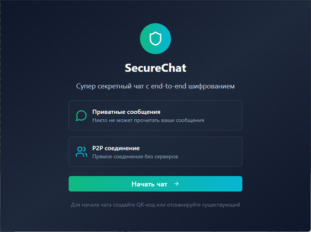
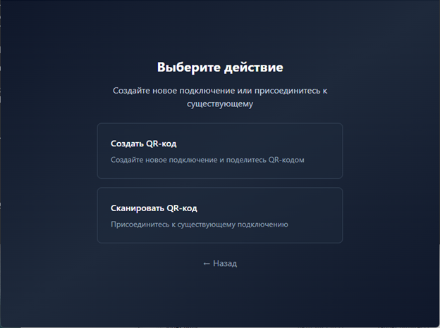
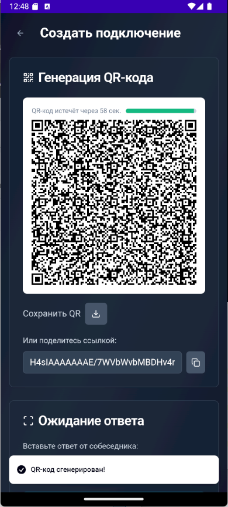
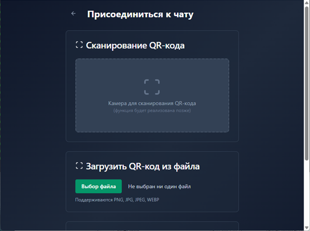
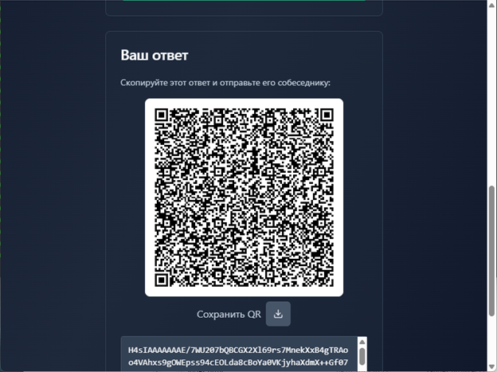
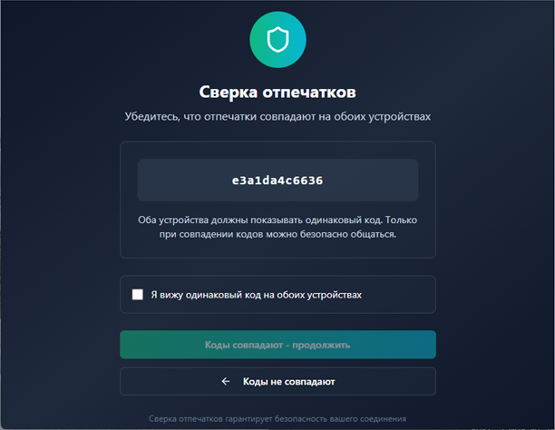
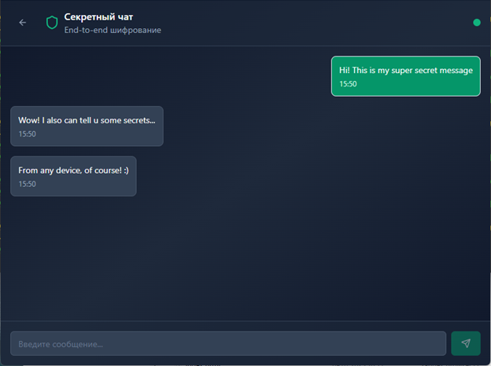
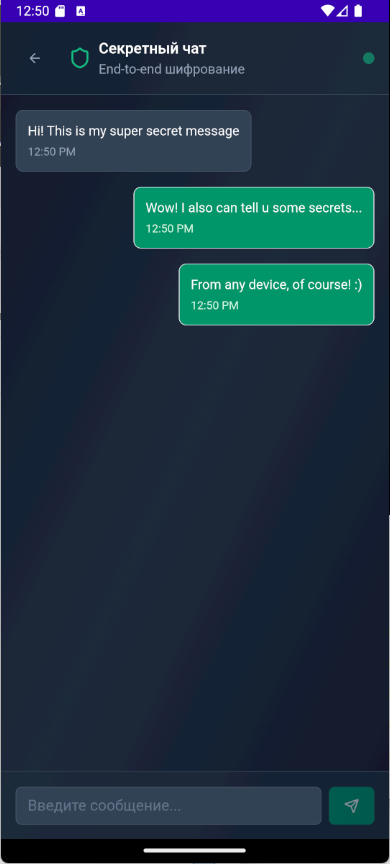
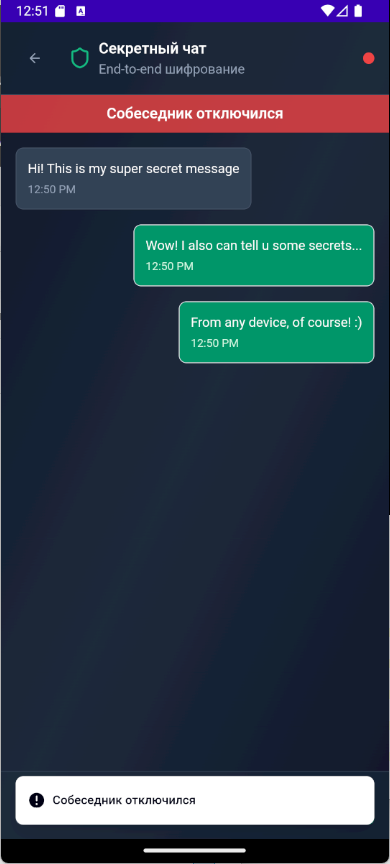

# ZeroID: Абсолютно секретный чат

> Desktop v3: [protocol, diagnostics and validation](docs/DESKTOP_PROTOCOL.md). Both participants must update; older invitations are unsupported.


**ZeroID**  — абсолютно секретный чат для безопасного общения без регистрации, авторизации и отслеживания. Ваше устройство и есть сервер, поэтому никто не сможет получить доступ к вашей переписке или истории сообщений.

## Оглавление 📚

- [Ключевые особенности](#ключевые-особенности-)
- [Поддерживаемые платформы](#поддерживаемые-платформы-)
- [Скриншоты](#скриншоты-)
- [Технический стек](#технический-стек-️) 
  - [Frontend](#frontend-)
  - [Backend (Core)](#backend-core-️)
- [Безопасность](#безопасность-)
  - [Что уже сделано для безопасности](#что-уже-сделано-для-безопасности-и-зачем-это-нужно)
  - [Что ещё предстоит сделать для безопасности](#что-ещё-нужно-сделать-для-безопасности)
- [Структура проекта](#структура-проекта-)
- [Сборка и запуск](#сборка-и-запуск-)
- [Безопасность](#безопасность-)
- [Будущие планы](#будущие-планы-)
- [Contributing](#contributing-)

## Ключевые особенности 🚀

- 🔒 **P2P-шифрование** на основе WebRTC и криптографии X25519, ChaCha20-Poly1305, HKDF.
- 🚫 **Отсутствие серверов**: приложение полностью децентрализовано и работает без внешних бэкендов.
- 🕵️‍♂️ **Полная анонимность**: никакой регистрации, никакой авторизации, никакой истории сообщений на сторонних серверах.
- ⚡ **Высокая скорость и надёжность**: соединение peer-to-peer с минимальной задержкой.

## Поддерживаемые платформы 💻

- 🖥️ Windows
- 🍎 macOS
- 🐧 Linux

Поддержка Android и iOS запланирована в будущем.

## Скриншоты 📸

Управление приложением одинаково для всех платформ.

### 🏠 Приветственный экран


Добро пожаловать в ZeroID! Здесь вы можете начать безопасное общение. Выберите способ подключения:
- **Создать QR-код** — для инициации соединения
- **Сканировать QR-код** — для подключения к собеседнику

### Создать/принять оффер

На данном этапе вы можете создать оффер или принять оффер от собеседника.


### 🔗 Создание QR-кода


Создайте уникальный QR-код для вашего собеседника. Этот код содержит зашифрованную информацию для установки защищённого соединения. Покажите его собеседнику для сканирования.
> Вы так же можете поделиться ссылкой созданного QR-кода для установки соединения.

### 📱 Сканирование QR-кода


Отсканируйте QR-код или введите полученный оффер, созданный вашим собеседником. Приложение автоматически установит защищённое peer-to-peer соединение.

### Передача ответа


После сканирования QR-кода или ввода оффера, приложение автоматически сгенерирует ответное сообщение с зашифрованным ответом. Передайте его пригласившему вас собеседнику.


### 🔐 Проверка отпечатка


После установки соединения сравните отпечатки безопасности (SAS) с собеседником. Если они совпадают — соединение защищено от атак "человек-посередине".

### 💬 Безопасный чат



Теперь вы можете общаться в абсолютно безопасном режиме! Все сообщения шифруются end-to-end с использованием ChaCha20-Poly1305. Никаких серверов, никакой истории сообщений.

### 🔌 Отключение


Завершите сессию одним кликом. Приложение очищает состояние сессии и удаляет объекты ключей; ограничения очистки памяти описаны ниже.


ZeroID также доступен на мобильных устройствах с тем же уровнем безопасности и удобства использования.

## Технический стек 🛠️

### Frontend 🌐

- [React](https://react.dev/) (TypeScript)
- [Radix UI](https://www.radix-ui.com/) - UI-компоненты и хуки
- [Tailwind CSS](https://tailwindcss.com/) - стилизация
- [Vite](https://vitejs.dev/) - сборщик
- [React Router](https://reactrouter.com/) - маршрутизация
- [React Hook Form](https://react-hook-form.com/) - управление формами
- FSD-архитектура

### Backend (Core) ⚙️

- [Rust](https://www.rust-lang.org/) - системный язык программирования
- [WebRTC](https://webrtc.org/) - peer-to-peer соединения
- [x25519-dalek](https://docs.rs/x25519-dalek/) - эфемерный X25519 ECDH
- [ChaCha20-Poly1305](https://github.com/RustCrypto/AEADs) - аутентифицированное шифрование
- [HKDF](https://github.com/RustCrypto/KDFs) - генерация ключей
- [Tauri](https://tauri.app/) - фреймворк для создания десктоп-приложений
- [Tokio](https://tokio.rs/) - асинхронная среда выполнения
- [Serde](https://serde.rs/) - сериализация/десериализация

## Ключевые аспекты безопасности 🔒

Desktop использует протокол v3 с обязательствами перед раскрытием ключей X25519.
Каждая сторона сначала фиксирует свежий публичный ключ и случайный nonce. Транскрипт
обмена с ролями и ID соединения связывает ключи HKDF и 12-символьный код SAS.
Оба участника должны сравнить весь код по доверенному каналу и подтвердить его.
Сервис знакомства видит SDP/ICE и может отказать в обслуживании или подменить сигнализацию;
если пропустить сверку SAS, защиты от подмены собеседника не будет.

ChaCha20-Poly1305 проверяет сообщения вместе с заголовками. Направления используют разные
ключи и возрастающие номера; повторы и переполнение отвергаются. Размер приглашений,
распаковки и сообщений ограничен. Закрытая или заменённая сессия отвергает запоздалые
события и очищает своё состояние.

Провайдер X25519 обнуляет принадлежащие ему приватный ключ и общий секрет при удалении.
Собственные буферы ключей и seed используют zeroization; AEAD-объекты очищают свои ключи.
Это частичная очистка памяти: внутренние данные HKDF, копии компилятора, строки WebView/JS,
буфер обмена, swap и crash dump гарантированно не стираются. Отключение не гарантирует
невозможность восстановления данных. Сохранённые TURN credentials остаются в localStorage
и зависят от защиты локальной учётной записи.

Подробности: [протокол и проверки](docs/DESKTOP_PROTOCOL.md),
[зависимости и ограничения](docs/SECURITY.md). Локальные тесты не подтверждают произвольные
маршруты NAT/TURN, сборки Windows/macOS или защищённость развёрнутого сервера.

## Структура проекта 📂

```
src/
├── App.css
├── App.tsx
├── components/
│   ├── FingerprintModal.tsx
│   └── ui/ (компоненты интерфейса)
├── hooks/
│   ├── use-mobile.tsx
│   └── use-toast.ts
├── lib/
│   └── utils.ts
├── main.tsx
└── pages/
    ├── Chat.tsx
    ├── GenerateQR.tsx
    ├── Index.tsx
    ├── NotFound.tsx
    ├── ScanQR.tsx
    └── Welcome.tsx

Ядро (Core):
src/
├── lib.rs
├── main.rs
├── signaling.rs
└── webrtc_peer.rs
```

## Сборка и запуск 🚧

Для сборки приложения требуется установить [пререквизиты Tauri](https://tauri.app/start/prerequisites/).

**Команды сборки:**

```bash
make build             # для Linux/macOS/Windows
make build-ios         # iOS (скоро)
make build-android     # Android (скоро)
```

После сборки приложение запускается локально. Нет необходимости в дополнительных развёртываниях.

## Безопасность 🔑

ZeroID реализует следующие подходы для обеспечения конфиденциальности и безопасности:

- 🔐 **End-to-End Encryption** с использованием ChaCha20-Poly1305.
- 🔑 **Key Exchange** на основе алгоритма ECDH (X25519).
- 📱 **СAS (Short Authentication String)** для безопасного подтверждения связи.
- 📵 **Отсутствие хранения истории сообщений** — данные существуют только на устройствах пользователей.

## Будущие планы 📅

- 📢 Групповые чаты
- 📁 Передача файлов
- 🎙️ Голосовые и видеосообщения
- 📱 Поддержка мобильных платформ (Android и iOS)

## Contributing 🤝

ZeroID открыт к вкладу сообщества.

- Rust код должен соответствовать стандартам Rust.
- Для frontend используется подход Feature-Sliced Design (FSD).
- Перед отправкой PR убедитесь, что код чистый и снабжён комментариями.

---

ZeroID — это ваше право на приватность и безопасность в сети!

